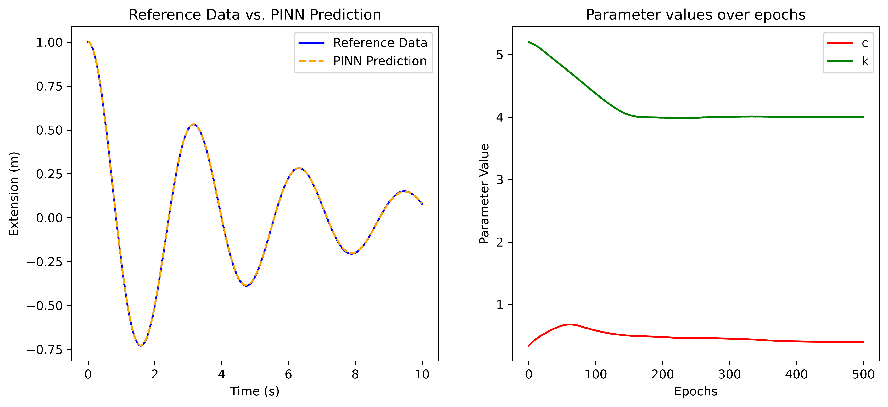

# Physics-Informed Neural Network (PINN) — Damped Oscillator

A PINN implementation in PyTorch that solves and identifies parameters of a damped harmonic oscillator.

## Problem

The network learns to solve the following ODE:

$$m\ddot{x} + c\dot{x} + kx = 0$$

Given reference observations, the network simultaneously:
- fits the trajectory $x(t)$
- identifies the unknown physical parameters $c$ and $k$

## Results

The network recovers the parameters from initial guesses $c_{\mathrm{init}}= c \cdot 0.85 $, $k_{\mathrm{init}}= k \cdot 1.3$:

| Parameter | True value | Identified |
|-----------|-----------|------------|
| c         | 0.4       | 0.4020      |
| k         | 4.0       | 3.9988      |



## Installation

```bash
python -m venv PINN
source PINN/bin/activate  # Linux/Mac
PINN\Scripts\activate     # Windows

pip install -r requirements.txt
```
## Usage

Activate the virtual environment first

```bash
source PINN/bin/activate  # Linux/Mac
PINN\Scripts\activate     # Windows
```
and then execute the script
```bash
python pinn.py
```

## Method

The loss function consists of three terms:

- **Physics Loss** — ODE residual must be zero
- **Data Loss** — network output must match reference trajectory  
- **IC Loss** — initial conditions $x(0)=1$, $\dot{x}(0)=0$ must be satisfied